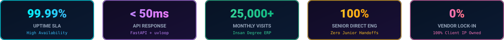
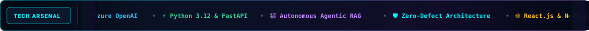

<div align="center">

  <!-- ================================================================= -->
  <!-- 1. DYNAMIC ANIMATED HERO BANNER (HOLOGRAPHIC & INFINITE SCROLLER)  -->
  <!-- ================================================================= -->
  <a href="https://codex404solutions.online" target="_blank">
    
  </a>

  <br><br>

  <!-- Executive Trust Badges -->
  <p align="center">
    <a href="https://codex404solutions.online"></a>
    <a href="https://linkedin.com/in/mnoukhej"></a>
    
    
    
  </p>

  <!-- Interactive Action Touchpoints -->
  <p align="center">
    <a href="https://codex404solutions.online" target="_blank">
      
    </a>
    &nbsp;
    <a href="https://codex404solutions.online/discovery-call.php" target="_blank">
      
    </a>
    &nbsp;
    <a href="https://wa.me/917717747620?text=Hi%20CodeX404%20Solutions%20Team%2C%20I'd%20like%20to%20discuss%20a%20high-scale%20project." target="_blank">
      
    </a>
    &nbsp;
    <a href="mailto:contact@codex404solutions.online">
      
    </a>
  </p>

  <br>

  <!-- Interactive Glowing Metrics Ribbon -->
  

</div>

---

<div align="center">
  <h2>⚡ <span style="color:#00f2fe;">The CodeX404 Standard</span> &nbsp;•&nbsp; <span style="color:#c084fc;">Executive Overview</span></h2>
  <p><em>"Software &amp; AI that Moves Business Forward • Where Bugs Meet Their Match"</em></p>
</div>

**CodeX404 Solutions** is a founder-led software engineering and artificial intelligence venture. We bridge the gap between high-level architectural innovation and battle-hardened enterprise execution. 

Founded and directed by **Muhammad Noukhez** — Senior AI Systems Architect with **7+ years of core research and development tenure at Tata Consultancy Services (TCS Research & Innovation / Research & Development teams)** and an **M.Tech in Computer Science & Engineering** — CodeX404 operates on a singular premise: **software should be deterministic, ultra-performant, and mathematically reliable**.

We partner with forward-thinking enterprises, funded startups, and institutional organizations worldwide to design and deploy high-throughput backend microservices, private Generative AI agents, and custom cloud infrastructure.

```
┌────────────────────────────────────────────────────────────────────────────────────────┐
│                              THE 4 ZERO-DEFECT PILLARS                                 │
├──────────────────────────┬──────────────────────────────┬──────────────────────────────┤
│  🎯 100% SENIOR ENG      │  🛡️ ZERO-DEFECT GUARANTEE    │  🔓 100% CLIENT IP OWNERSHIP │
│  Every line architected  │  Defensive schemas, static   │  Docker containerized, open  │
│  by principal engineers. │  typing, sub-50ms latency.   │  infrastructure, no lock-in. │
└──────────────────────────┴──────────────────────────────┴──────────────────────────────┘
```

---

<div align="center">
  <h2>🛡️ <span style="color:#38bdf8;">The Four Engineering Pillars</span></h2>
</div>

<table>
  <tr>
    <td width="50%" valign="top">
      <h3>🎯 1. 100% Senior Direct Engineering</h3>
      <p>We do not operate like traditional agencies that pitch senior partners and delegate execution to junior apprentices. Every project at CodeX404 is architected, developed, and security-reviewed directly by principal engineers with Fortune 500 enterprise pedigrees.</p>
      <ul>
        <li><strong>Direct Technical Leadership:</strong> Direct access to the lead architect.</li>
        <li><strong>High Signal-to-Noise Ratio:</strong> Clean, defensive, and documented codebases.</li>
        <li><strong>Velocity Without Technical Debt:</strong> Systems designed right the first time.</li>
      </ul>
    </td>
    <td width="50%" valign="top">
      <h3>🛡️ 2. Deterministic Zero-Defect Guarantee</h3>
      <p>True to our motto — <em>"Where Bugs Meet Their Match"</em> — our engineering methodology is rooted in formal verification, strict typing, automated test harnesses, and idempotent system states.</p>
      <ul>
        <li><strong>Sub-50ms Microservices:</strong> High-throughput async endpoints.</li>
        <li><strong>Defensive Edge Validation:</strong> Schema enforcement via Pydantic &amp; Zod.</li>
        <li><strong>Proactive Telemetry:</strong> Structured logging and distributed tracing.</li>
      </ul>
    </td>
  </tr>
  <tr>
    <td width="50%" valign="top">
      <h3>🔓 3. 100% Client IP &amp; Zero Lock-In</h3>
      <p>Your software is your competitive moat. We ensure that you own 100% of the intellectual property, configuration files, deployment scripts, and documentation upon delivery.</p>
      <ul>
        <li><strong>Cloud-Agnostic Containers:</strong> Dockerized for AWS, Azure, GCP, or Bare Metal.</li>
        <li><strong>Comprehensive Handover:</strong> Clear API contracts, OpenAPI specs, and guides.</li>
        <li><strong>No Hidden Royalties:</strong> Pure, transparent engineering ownership.</li>
      </ul>
    </td>
    <td width="50%" valign="top">
      <h3>🌐 4. Global Delivery &amp; High Concurrency</h3>
      <p>From institutional portals handling tens of thousands of concurrent users to cross-border FinTech webhooks, our solutions are engineered for global scale and resilience.</p>
      <ul>
        <li><strong>Global Footprint:</strong> Clients in US, UK, UAE, KSA, CA, AU, and India.</li>
        <li><strong>Multi-Rail Integrations:</strong> Stripe, Razorpay, WhatsApp Business APIs.</li>
        <li><strong>High-Availability SLA:</strong> 99.99% uptime architectures.</li>
      </ul>
    </td>
  </tr>
</table>

---

<div align="center">
  <h2>💼 <span style="color:#a855f7;">Practice Areas &amp; Solutions Matrix</span></h2>
  <br>
  <!-- Animated Typing Terminal Pipeline Widget -->
  
  <br><br>
</div>

### 🤖 1. Enterprise Generative AI & Autonomous Systems
We engineer production-grade Generative AI pipelines that move beyond simple wrappers into secure, private, enterprise-ready cognitive engines:
* **Private Agentic RAG Pipelines:** High-precision semantic search and retrieval using **Qdrant**, **Pinecone**, and **Azure OpenAI embeddings**, integrated with strict hallucination firewalls.
* **Autonomous Multi-Agent Networks:** Tool-calling agentic loops capable of multi-step reasoning, ERP data extraction, and automated cross-platform decision execution.
* **LLM Fine-Tuning & Prompt Engineering:** Custom model adaptation for domain-specific industry workflows (legal, medical, higher education, finance).
* **Computer Vision & Threat Intelligence:** Real-time object detection and classification leveraging **YOLO**, **OpenCV**, and custom PyTorch backbones.

### ⚡ 2. High-Throughput Backends & Distributed Systems
Engineered for ultra-low latency, defensive reliability, and horizontal elasticity:
* **Asynchronous API Architectures:** Sub-50ms response latency microservices powered by **FastAPI**, **Django Ninja**, and **Node.js**.
* **Distributed Task Queues & Pub/Sub:** Asynchronous event-driven workflows utilizing **Celery**, **Redis**, and **RabbitMQ** for massive concurrent jobs.
* **Database Optimization & Sharding:** Relational (PostgreSQL, MySQL) and NoSQL (MongoDB, Redis) performance tuning, indexing, and connection pooling.
* **Enterprise Authentication & Security:** OAuth2, JWT, Role-Based Access Control (RBAC), and bank-grade data encryption at rest and in transit.

### 🌐 3. Full-Stack SaaS & Modern Web Applications
Dynamic, responsive, and conversion-optimized digital experiences built for high-growth ventures:
* **Modern Frontend Architectures:** High-performance single-page and server-rendered web applications built on **React.js**, **Next.js**, and modern component systems.
* **Enterprise Design Systems:** Responsive dark/light glassmorphic UI, modern typography, and WCAG-compliant accessible interfaces.
* **Payment Rails & Webhook Engines:** Idempotent, SCA-compliant payment flows integrating **Stripe**, **Razorpay**, and automated invoice dispatching.

### 🏫 4. Institutional Portals & Mission-Critical ERPs
Scalable management systems for high-traffic institutions, government portals, and educational organizations:
* **Case Study — Insan Degree College ERP:** Custom institutional platform handling **25,000+ monthly active visits** during peak admission season with **zero downtime** and instant certificate validation ([Live Portal](https://insandegreeclg.codex404solutions.online/)).
* **Complex Data Management:** Student lifecycles, automated fee reconciliation, dynamic exam scheduling, and role-segregated admin consoles.

### 🔄 5. Enterprise Workflow & Systems Automation
End-to-end automation pipelines that replace manual administrative overhead with automated intelligence:
* **WhatsApp Business API Solutions:** Automated lead nurturing, two-way conversational bots, and transactional notification engines.
* **CRM & ERP Synchronization:** Bi-directional real-time data sync across disparate enterprise systems.

---

<div align="center">
  <h2>🛠️ <span style="color:#00f2fe;">Continuous Tech Scroller</span> &nbsp;•&nbsp; <span style="color:#34d399;">Active Arsenal</span></h2>
  <br>

  <!-- Animated Continuous Tech Scroller Marquee -->
  

  <br><br>

  <p>
    
    
    
    
    
    
    
    
    
    
    
    
    
  </p>
</div>

---

<div align="center">
  <h2>🚀 <span style="color:#fbbf24;">Featured Enterprise &amp; Production Showcase</span></h2>
</div>

<table>
  <tr>
    <td width="50%" valign="top">
      <h4>🌐 <a href="https://codex404solutions.online">CodeX404 Solutions Portal</a></h4>
      <p>The centralized hub for our studio's software engineering services, client discovery systems, case studies, and enterprise inquiry pipelines.</p>
      <p>
        
        
      </p>
    </td>
    <td width="50%" valign="top">
      <h4>🏫 <a href="https://insandegreeclg.codex404solutions.online">Insan Degree College ERP</a></h4>
      <p>Comprehensive educational enterprise portal serving 25,000+ active visits with instantaneous admission workflows and verified certificate verification.</p>
      <p>
        
        
      </p>
    </td>
  </tr>
  <tr>
    <td width="50%" valign="top">
      <h4>🛡️ <a href="https://github.com/mnoukhej/Instrusion-Detection-System">Intrusion Detection System</a></h4>
      <p>Machine-learning-driven network intrusion detection engine classifying anomalies and attack signatures in real-time network traffic.</p>
      <p>
        
        
      </p>
    </td>
    <td width="50%" valign="top">
      <h4>🤖 <a href="https://github.com/mnoukhej/Spam_Email_Detection">Spam &amp; Threat Intelligence Engine</a></h4>
      <p>High-accuracy natural language processing system filtering malicious communication vectors and phishing anomalies using NLP models.</p>
      <p>
        
        
      </p>
    </td>
  </tr>
</table>

---

<div align="center">
  <h2>🔄 <span style="color:#00f2fe;">The CodeX404 5-Stage Delivery Framework</span></h2>
</div>

```
[1. Deep Discovery] ──► [2. System Blueprint] ──► [3. Sprint Execution] ──► [4. Hardening & QA] ──► [5. Production & IP Handover]
   Within 48h              Architecture & Data      Direct Senior Code       Sub-50ms Benchmarks      100% Client Ownership
   Technical Scoping       Schema Specifications    Continuous Integration    Zero-Defect Audit        Zero Vendor Lock-In
```

1. **Phase 1: Deep Architectural Discovery (Within 48 Hours)**  
   Direct consultation with our lead architect to analyze business logic, throughput requirements, latency constraints, and security models.
2. **Phase 2: System Blueprint & Threat Modeling**  
   Before any code is committed, we deliver formal architectural blueprints, OpenAPI specifications, database ER diagrams, and infrastructure topologies.
3. **Phase 3: Senior Sprint Execution**  
   Rapid, deterministic sprint execution. Every line of backend and AI logic is written with defensive typing, integration tests, and container configs.
4. **Phase 4: Security Hardening & Performance Benchmarking**  
   Comprehensive load testing (stress testing to 10k+ concurrent requests), SQL query indexing, OWASP vulnerability scans, and sub-50ms latency tuning.
5. **Phase 5: Production Deployment & Complete IP Handover**  
   Turnkey deployment to client cloud infrastructure (AWS/Azure/GCP). We hand over 100% code ownership, secrets documentation, and SLA support.

---

<div align="center">
  <h2>🌐 <span style="color:#38bdf8;">Global Reach &amp; Engagement Footprint</span></h2>
</div>

<div align="center">

| Region | Engagement Focus | Representative Capabilities |
| :--- | :--- | :--- |
| **🇺🇸 United States** | Enterprise AI, Autonomous Agents &amp; SaaS | Multi-tool Agentic RAG, Microservices, Cloud Modernization |
| **🇬🇧 United Kingdom** | High-Concurrency Backends &amp; APIs | Financial Data Pipelines, Asynchronous FastAPI / Redis Engines |
| **🇦🇪 United Arab Emirates** | Smart Workflow Automations &amp; Portals | WhatsApp Cloud API Integrations, CRM Pipelines, Enterprise Web |
| **🇸🇦 Saudi Arabia** | Cloud Transformation &amp; AI Solutions | Enterprise Resource Planning, Private Vector Search, Microservices |
| **🇨🇦 Canada** | SaaS Application Architecture | React / Next.js Full-Stack Platforms, Secure Payment Gateways |
| **🇦🇺 Australia** | Cloud Engineering &amp; Data Integration | High-availability backend systems, Dockerized microservices |
| **🇮🇳 India** | Institutional ERPs &amp; Enterprise Systems | High-volume student portals (25,000+ MAU), Custom SaaS MVPs |

</div>

---

<div align="center">
  <h2>🤝 <span style="color:#c084fc;">Leadership &amp; Pedigree</span></h2>
</div>

<table border="0">
  <tr>
    <td width="120" align="center" valign="middle">
      <a href="https://linkedin.com/in/mnoukhej">
        
      </a>
    </td>
    <td valign="middle">
      <strong>Muhammad Noukhez</strong> — <em>Founder, CEO &amp; Principal AI Systems Architect</em><br>
      • <strong>7+ Years Enterprise Experience at Tata Consultancy Services (TCS)</strong> across Research &amp; Innovation (RnI) and Research &amp; Development (RnD) teams.<br>
      • Specialized in enterprise Azure OpenAI deployments, high-throughput asynchronous Python/FastAPI architectures, and mission-critical production support.<br>
      • <strong>Master of Technology (M.Tech)</strong> in Computer Science &amp; Engineering.<br>
      • Direct Touchpoint: <a href="https://linkedin.com/in/mnoukhej">linkedin.com/in/mnoukhej</a> &nbsp;|&nbsp; <a href="https://github.com/mnoukhej">github.com/mnoukhej</a>
    </td>
  </tr>
</table>

---

<div align="center">

  <h2>📬 <span style="color:#00f2fe;">Initiate an Enterprise Engagement</span></h2>
  <p>Ready to deploy deterministic AI systems, sub-50ms APIs, or mission-critical cloud software?</p>

  <table style="border: none; background: transparent;">
    <tr>
      <td align="center" style="padding: 12px;">
        <a href="https://codex404solutions.online/discovery-call.php" target="_blank">
          
        </a>
      </td>
      <td align="center" style="padding: 12px;">
        <a href="mailto:contact@codex404solutions.online">
          
        </a>
      </td>
      <td align="center" style="padding: 12px;">
        <a href="https://wa.me/917717747620?text=Hello%20CodeX404%20Solutions%2C%20I%20would%20like%20to%20discuss%20a%20technical%20project." target="_blank">
          
        </a>
      </td>
    </tr>
  </table>

  <br>

  <p align="center">
    <strong>CodeX404 Solutions</strong> &nbsp;•&nbsp; <em>Where Bugs Meet Their Match</em><br>
    <a href="https://codex404solutions.online">codex404solutions.online</a> &nbsp;•&nbsp; <a href="mailto:contact@codex404solutions.online">contact@codex404solutions.online</a> &nbsp;•&nbsp; Global Remote &amp; Worldwide Delivery
  </p>

  <p align="center">
    
  </p>

</div>
